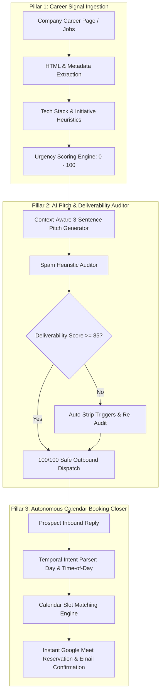

# AutoSDR ⚡ — Autonomous Signal-Based Outbound & Calendar Closer

> An end-to-end autonomous sales intelligence platform that ingests real-time hiring & tech stack signals, generates hyper-personalized deliverability-safe cold pitches, and autonomously books demo meetings via natural language calendar negotiation.

---

## 🏗️ Architecture & Pipeline Flow



---

## 🚀 Why AutoSDR?

Traditional outbound is dying. Blasting generic 1,000-lead CSV lists results in domain blacklisting, high spam complaint rates (> 0.3%), and single-digit open rates.

**AutoSDR solves outbound at the protocol and timing level:**
1. **Signal-Driven Timing**: Instead of guessing when a company needs software, AutoSDR tracks active hiring triggers (e.g. Stripe hiring Staff Infrastructure Engineers to scale payment throughput).
2. **Deliverability-First AI**: Every generated pitch passes through an anti-spam heuristic scanner (evaluating link density, shouty caps, spam trigger phrases, and word count) before touching an SMTP server.
3. **Frictionless Inbound Conversion**: When a prospect replies *"Sounds interesting! Are you available Thursday afternoon?"*, the autonomous calendar agent parses temporal intent, locks the calendar slot, and dispatches a Google Meet invite in seconds.

---

## 🛠️ Core Engineering Pillars

### 📡 1. Event Signal Detector (`src/signals/jobScraper.ts`)
- Ingests active job listings across targeted tech companies.
- Extracts engineering tech stack footprints (`Python`, `Go`, `Redis`, `OpenAI`, `TypeScript`).
- Computes an **Urgency Score (0–100)** based on seniority, infrastructure bottlenecks, and mission-critical initiatives.
- Formulates high-relevance sales hooks used directly in outbound copy.

### 🛡️ 2. AI Deliverability & Spam Auditor (`src/ai/spamScore.ts` & `src/ai/llmEngine.ts`)
- **3-Sentence High-Conversion Pitch Structure**:
  1. *Observation*: Proves real research on their active role.
  2. *Value Proposition*: Ties directly to their detected tech stack.
  3. *Zero-Friction CTA*: 2-minute interactive demo ask.
- **Strict Spam Audit Engine**:
  - Word count threshold (< 100 words for optimal mobile engagement).
  - Link density checks (penalizes drafts with > 1 link).
  - Punctuation & ALL-CAPS heuristic filters.
  - Blacklist filter for 20+ spam trigger phrases (*"guaranteed"*, *"risk-free"*, *"click here"*).

### 📅 3. Autonomous Calendar Booking Closer (`src/calender/bookingAgent.ts`)
- **Temporal Intent Parsing**: Detects weekdays (*"Thursday"*, *"tomorrow"*) and time windows (*"morning"*, *"afternoon"*, *"2:00 PM"*).
- **Dynamic Slot Matcher**: Queries open calendar availability and matches the closest slot.
- **Autonomous Confirmation Generator**: Formulates a warm human confirmation with meeting coordinates and alternative booking slots.

---

## 💻 Tech Stack

- **Backend Runtime**: Node.js, TypeScript, Express 5
- **Tooling**: `tsx` (TypeScript Execution Engine)
- **Frontend / Dashboard**: TailwindCSS, Vanilla JS, Dark Mode UI
- **Architecture**: Modular Service-Oriented Pipeline (Signals ➔ LLM Engine ➔ Spam Auditor ➔ Calendar Agent)

---

## ⚡ Quickstart & Local Setup

### 1. Install Dependencies
```bash
npm install
```

### 2. Run Direct CLI Unit Tests
Verify each pillar independently via terminal:

```bash
# Test Pillar 1: Signal Scraper & Urgency Detector
npx tsx src/signals/jobScraper.ts

# Test Pillar 2: AI Pitch Generator & Deliverability Spam Audit
npx tsx src/ai/llmEngine.ts

# Test Pillar 3: Autonomous Calendar Booking Closer
npx tsx src/calender/bookingAgent.ts
```

### 3. Launch Mission Control Dashboard
```bash
npx tsx src/server.ts
```

Open your browser to:
👉 **`http://localhost:5000`**

---

## 📊 Live Endpoints

| Method | Endpoint | Description |
|---|---|---|
| `POST` | `/api/signals/scan-and-pitch` | Scans company career signals, extracts tech stack, drafts 3-sentence pitch, audits deliverability score. |
| `POST` | `/api/calendar/auto-book` | Parses prospect inbound reply text, extracts temporal intent, and reserves calendar slot. |

---

## 🛡️ License
MIT License. Built for high-performance B2B outbound engineering.
